<div align="center">


# 咔捕 CatchSnap

**纯本地免服「抖音 / 小红书」超清无水印下载器 · 原画解析 · LivePhoto 实况 · 流体云灵动胶囊**

<p align="center">
  <sub>Local Douyin & Xiaohongshu (RED) Media Downloader built with Flutter & Kotlin</sub>
</p>

[](https://github.com/Jolly-J/CatchSnap/releases/tag/v1.0.0)
[](https://developer.android.com/)
[](https://flutter.dev/)
[](https://kotlinlang.org/)
[](LICENSE)
[](#-纯本地免服解析-privacy-first)

*不管是抖音超清原画、小红书高码率视频与无损图集，还是动态实况素材，一键捕获，直存相册。*

</div>

---

## 💡 为什么做咔捕？

平时在手机上保存抖音灵感视频或小红书实用图集，最让人头疼的往往不是找不到好内容，而是**下载与保存的体验极度糟糕**：

1. **到处强弹广告与隐私泄漏**：市面上大部分所谓“去水印小程序”和解析网站，充斥着繁琐的观看广告诱导；更严重的是，它们要求把链接先传到未知的云端中转服务器，你的浏览足迹与个人鉴权 Cookie 随时面临泄露风险；
2. **画质严重降级与阉割**：未经官方授权或未登录状态下，平台通常只下发 720p 甚至 540p 的高度压缩流，想要保存原画级 1080p 超清视频几乎不可能；
3. **小红书实况（LivePhoto）直接报废**：传统工具无法解析动态实况素材，保存出来变成了模糊的静态图甚至下载失败；
4. **下载龟速、后台必断**：传统单线程单流下载在大体积视频或图集面前慢如蜗牛，切出 App 稍久就被系统直接杀死，必须重新排队；
5. **剪贴板频繁骚扰**：一些工具后台常驻常读系统剪贴板，每次切换应用都冷不防弹个打扰提示。

我就在想：**为什么不能有一个干干净净、纯本地跑的现代化下载器？**  
“不建后端服务器、不转存用户凭据、用多线程直接在手机本地跑满带宽，切到后台还能通过灵动胶囊随时瞄一眼进度。”

**咔捕 CatchSnap** 就是为了终结上述痛点而打造的开源工具：采用 **Flutter + 原生 Kotlin** 深度混合开发，遵循 **爱彼迎 (Airbnb) 温润设计系统**，所有解析与下载逻辑 100% 在手机本地闭环完成，保护隐私、拒绝广告，带来细腻舒适的媒体采集体验。

---

## ⚖️ 核心维度对比（为什么选择咔捕？）

| 核心维度 | 市面去水印小程序 / 在线解析网 | 传统多媒体下载工具 | 🌟 **咔捕 CatchSnap** |
| :--- | :--- | :--- | :--- |
| **解析架构** | 强制云端服务器中转 | 云端中转或混杂 | **100% 手机端本地闭环解析，零中转** |
| **用户隐私** | 搜集设备指纹、剪贴板与 Cookie | 行为追踪、回传下载历史 | **零数据上云，私有沙盒加密隔离** |
| **视频画质** | 强制压缩为 720p / 540p | 视源站普通下发 | **支持官方 Web 鉴权，解锁 1080p 原画** |
| **小红书实况** | 不支持（只能存静态图或直接报错） | 大多不支持 | **完美支持 LivePhoto 动态实况图无损提取** |
| **下载引擎** | 单线程单连接，频繁超时断流 | 普通单流下载 | **1~8 线程 Range 分片并发拉取，跑满带宽** |
| **使用体验** | 强制看 30s 广告、诱导付费会员 | 开屏弹窗、粗糙直角风格 | **0 广告、完全开源、Airbnb 温润设计体系** |
| **后台状态感知** | 切到后台即断流 | 仅系统通知栏普通文本 | **流体云灵动胶囊 + 桌面悬浮岛 + 原生预测式返回** |

---

## 📸 界面一览

### 1. 经典视觉与解析详情
| 主页 (爱彼迎极简风格) | 折叠屏大屏深度自适应 | 剪贴板按需感知抽屉 |
| :---: | :---: | :---: |
| 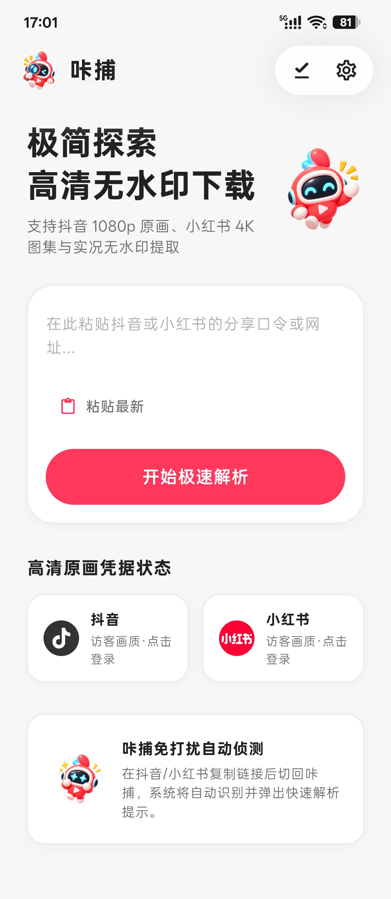 | 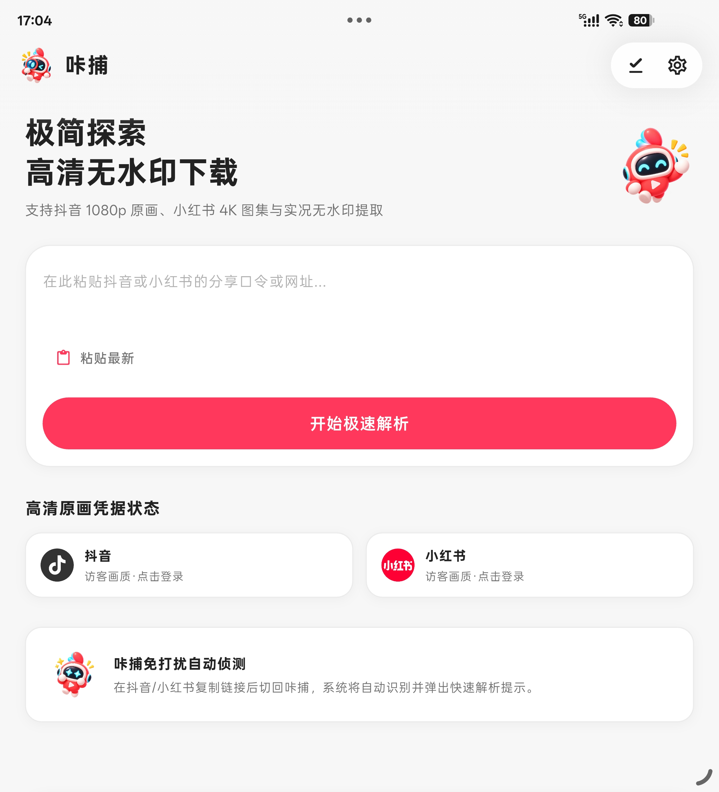 | 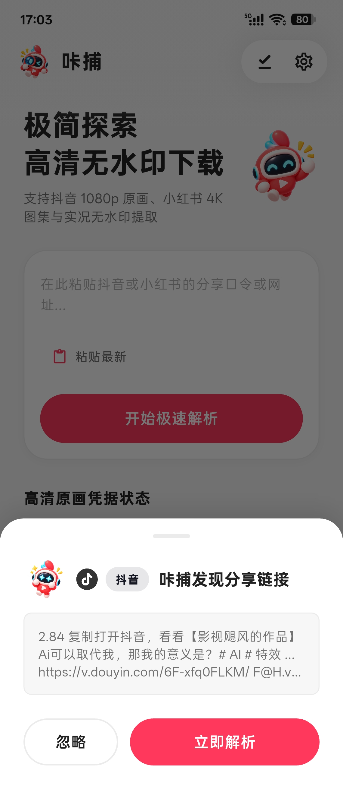 |

| 抖音 1080p 超清无水印详情 | 小红书原画视频 / 图集解析 | Android 14 预测式返回动画 |
| :---: | :---: | :---: |
| 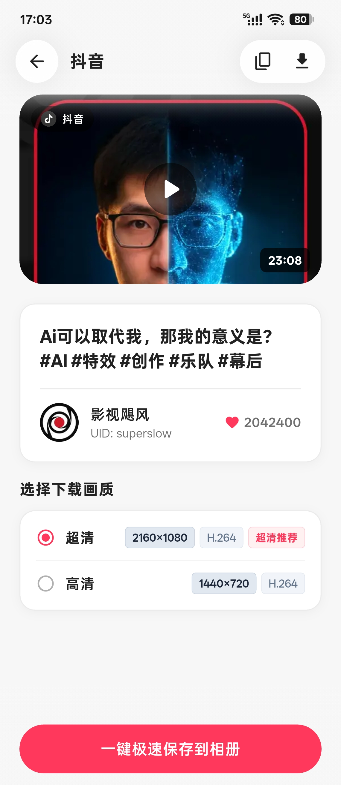 | 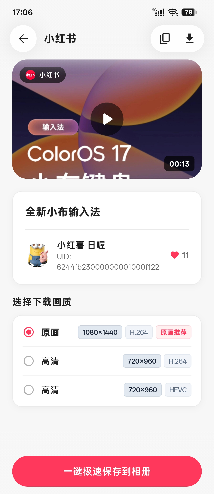 | 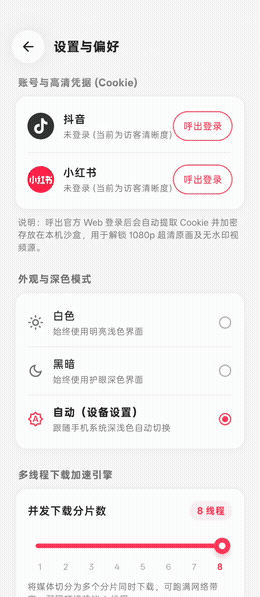 |

### 2. 全维状态感知与任务调度
| 悬浮灵动胶囊 (流体云) | 桌面 / 应用上方实时灵动岛 | 系统通知中心大卡片 |
| :---: | :---: | :---: |
| 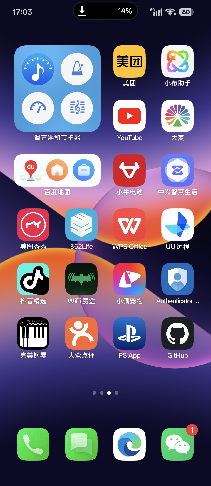 | 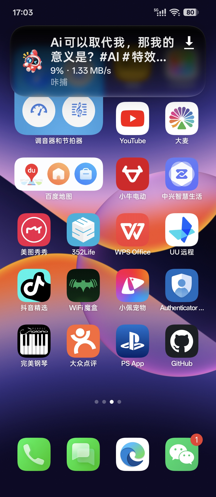 | 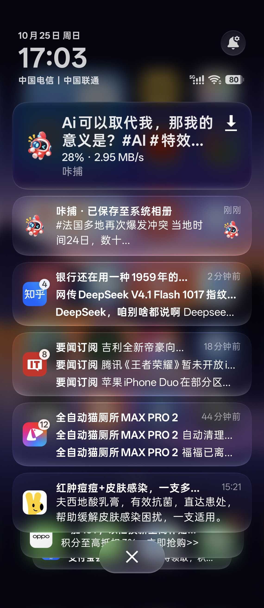 |

| 下载中 (多任务实时分片) | 已完成 (相册快速归档) | 设置与偏好控制台 |
| :---: | :---: | :---: |
| 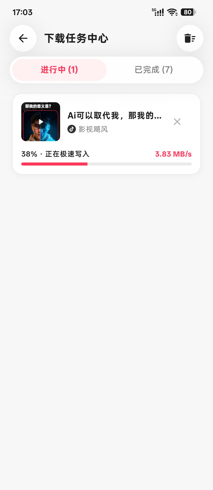 | 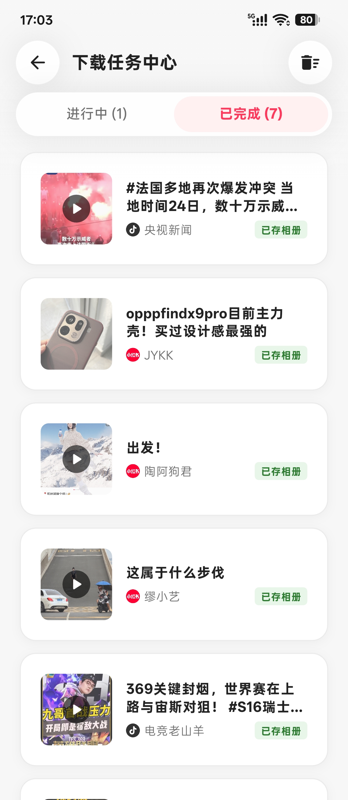 | 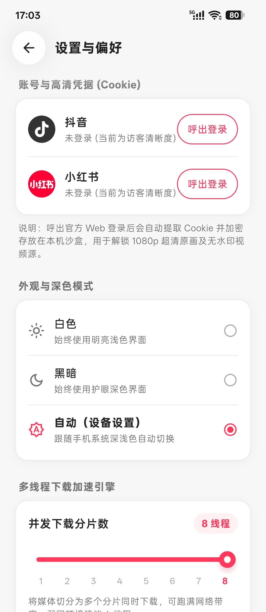 |

---

## ✨ 核心特性

### 🛡️ 1. 纯本地免服解析 (Privacy First)
* **零外部后端依赖**：彻底剥离自建服务器，短链还原、重定向追踪、页面 DOM 与 API 数据清洗全部在手机本地运行，用户凭据与下载历史绝不上云；
* **抖音 (Douyin) 深度解析**：支持口令、短链接（`v.douyin.com`）与网页长链，精准提取 1080p 超清无水印原画视频、音频原声与原图；
* **小红书 (Xiaohongshu) 全能解析**：支持 `xhslink.com` 短链解析、多码率自适应视频流、高清无损图集，并支持动态实况素材（LivePhoto）识别与无损分离。

### 🔑 2. 内置官方安全 Web 登录，解锁高清 Cookie
* **官方移动端鉴权**：在设置或首页可一键呼出平台官方登录页（支持验证码或扫码安全登录）；
* **本地沙盒凭据隔离**：登录成功后自动捕获 Cookie 并加密持久化在应用私有沙盒内，直接解锁平台只针对登录用户下发的最高画质流（4K/1080p 60fps）；
* **状态可视化**：首页清晰指示当前平台凭据有效性，支持一键更新或随时抹除。

### ⚡ 3. 高性能 HTTP Range 分片并发引擎
* **跑满手机带宽**：内置分片下载调度器，将大文件智能拆解为 1~8 个并发分片（Range Chunks）并行拉取，大文件下载速度相比传统单流提升 3~5 倍；
* **断点续传与弹性降级**：网络波动自动恢复分片；若源站 CDN 不支持 Range，无缝平滑回退为标准流式下载，确保 100% 成功率。

### 🌊 4. 新科技体验：流体云灵动胶囊 (Fluid Cloud)
* **应用内流体胶囊**：下载进行时，在顶部优雅展开深色药丸胶囊，毫秒级反馈实时网速（MB/s）、进度百分比与分片状态；
* **系统级悬浮灵动岛**：开启悬浮胶囊后，即使切换到桌面或其它 App 刷视频，屏幕上方仍可静默驻留灵动胶囊，点击即可呼出详情；
* **通知中心高刷联动**：完美适配 Android 原生通知中心大卡片与进度条，下载完成自动伴随温和震动与提示音。

### 🎨 5. 爱彼迎 (Airbnb) 设计美学与现代 Android 特性
* **设计语言**：选用温润优雅的珊瑚红（`#FF385C`）、高纯度浅灰（`#F7F7F7`）、漫反射大圆角卡片（16~24dp）与细腻微边框；
* **现代触感交互**：集成 **Android 14+ 预测式返回动画 (Predictive Back)**，全屏手势滑动返回时丝滑缩放预览；
* **折叠屏内屏自适应**：自动适配展开态大屏，双列多卡片自适应流式排版；
* **合规与省电优先**：严禁后台轮询系统剪贴板，仅在冷启动或用户切回前台瞬间进行单次轻量探查，并以底部模态抽屉优雅询问，杜绝电量偷跑。

---

## 📱 3 步快速上手（开箱即用）

1. **复制分享口令 / 链接**：在抖音或小红书 App 中点击分享，复制视频或图集的分享口令或网址；
2. **打开咔捕 CatchSnap**：应用会自动感知剪贴板内容，轻点底部弹出的感知抽屉即可秒级解析；
3. **选择画质并极速保存**：点击选择 1080p 超清原画、音频原声或 LivePhoto，分片并发直存系统相册！

---

## 🏗️ 架构设计与工程规范

本项目遵循模块化 **Clean Architecture** 规范，分层清晰，便于阅读与持续迭代：

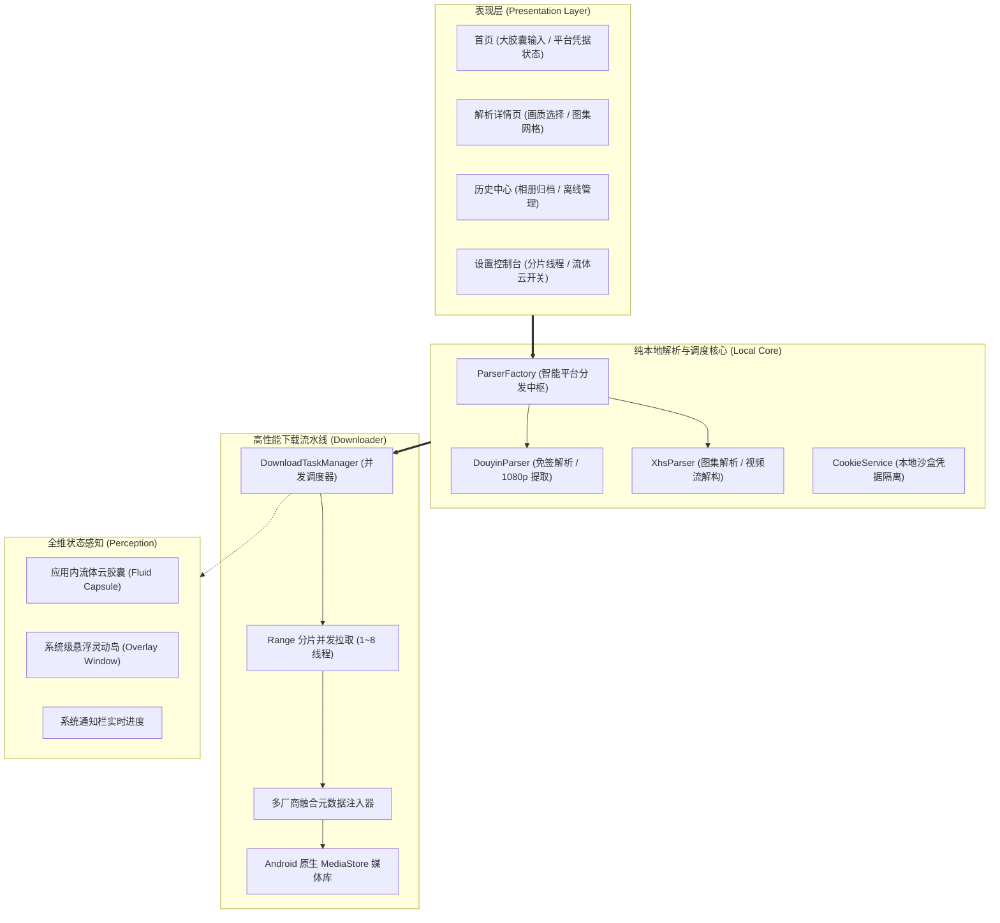

### 核心目录结构
```text
lib/
├── main.dart                                # 应用全局入口与沉浸式状态栏调度
├── app_theme.dart                           # 爱彼迎设计规范、颜色与阴影令牌
│
├── core/                                    # 基础底层引擎
│   ├── constants.dart                       # 全局常量、UA 与键名规范
│   ├── download_engine.dart                 # 高性能多线程 Range 分片并发核心
│   └── security_storage.dart                # 本地安全与配置持久化门面
│
├── models/                                  # 核心数据模型
│   ├── platform_type.dart                   # 平台枚举与品牌色映射
│   ├── media_item.dart                      # 归一化媒体实体 (视频流/多画质/图集)
│   └── download_task.dart                   # 下载任务与分片状态实体
│
├── parsers/                                 # 纯本地解析器引擎层
│   ├── base_parser.dart                     # 抽象解析基类接口
│   ├── parser_factory.dart                  # 智能平台路由与解析调度中枢
│   ├── douyin_parser.dart                   # 抖音本地高清免签解析器
│   └── xhs_parser.dart                      # 小红书本地高清解析器
│
├── services/                                # 业务系统能力服务
│   ├── clipboard_service.dart               # 进 App 单次剪贴板感知服务
│   ├── cookie_service.dart                  # 账号 Cookie 凭据管理服务
│   ├── download_task_manager.dart           # 下载调度与 MediaStore 相册归档
│   ├── permission_service.dart              # Just-In-Time 按需权限服务
│   └── fluid_cloud_service.dart             # 流体云胶囊调度服务
│
├── utils/                                   # 纯函数工具库
│   ├── link_extractor.dart                  # 正则提取有效 URL
│   ├── format_utils.dart                    # 尺寸、速率、时长格式化
│   └── motion_photo_synthesizer.dart        # 多厂商元数据合成引擎
│
├── widgets/                                 # 爱彼迎原子组件库
│   ├── airbnb_button.dart                   # 经典胶囊按钮与微触感动效
│   ├── airbnb_card.dart                     # 漫反射微阴影圆角卡片
│   ├── fluid_cloud_capsule.dart             # 顶部灵动药丸胶囊组件
│   └── clipboard_prompt_sheet.dart          # 底部优雅剪贴板唤起抽屉
│
└── screens/                                 # 表现层交互页面
    ├── home_screen.dart                     # 首页 (大胶囊输入、平台凭据状态、流体云)
    ├── video_detail_screen.dart             # 详情页 (画质档位选择、图集网格、极速下载)
    ├── web_login_screen.dart                # 内置 WebView 登录获取 Cookie 页面
    ├── history_screen.dart                  # 历史素材库管理
    └── settings_screen.dart                 # 设置页 (多线程调节、流体云控制、相册管理)
```

---

## 🚀 获取与构建

### 方式一：直接下载安装包（推荐）

您可以直接前往 [GitHub Releases](https://github.com/Jolly-J/CatchSnap/releases) 获取已签名的最新发布版 APK 安装包：

- 📦 **正式版发布页**：[GitHub Releases / v1.0.0](https://github.com/Jolly-J/CatchSnap/releases/tag/v1.0.0)
- 📲 **系统要求**：Android 10.0+（推荐 Android 14+ 享受最佳预测式返回与悬浮流体云手感）

1.0.0 是咔捕正式发布版本，构建号为 2，使用新的专用发布证书。此前的 `2.0.0-beta1` 使用调试证书，无法直接覆盖安装；已有测试版用户需自行保留所需资料后卸载重装，卸载会清除应用本地配置、登录会话和下载记录。

桌面图标采用暖白底，包含 Android 自适应、单色主题和旧系统兼容资源。品牌原图、商店素材及规范说明统一保存在 [品牌元素](品牌元素/README.md)。

### 方式二：从源码构建

如果您希望自行折腾、修改或二次开发：

```bash
# 1. 克隆本仓库到本地
git clone https://github.com/Jolly-J/CatchSnap.git
cd CatchSnap

# 2. 安装 Flutter 依赖包
flutter pub get

# 3. 连接 Android 真机或模拟器运行
flutter run

# 4. 首次发布前，按示例配置自己的签名证书（不要提交密钥或密码）
cp android/key.properties.example android/key.properties
# 编辑 android/key.properties 并将自己的证书放到对应位置

# 5. 编译 Release 发布版 APK
flutter build apk --release --no-tree-shake-icons
```

---

## 🔒 隐私与免责声明

1. **隐私至上 (Privacy First)**：本项目承诺**不设任何中心化收集服务器**，所有解析算法、网络请求与 Cookie 均完全在用户设备本地执行，绝不回传任何个人数据；
2. **合法使用**：本项目仅供个人离线学习、研究及正当灵感素材收藏之用。用户使用本工具下载的所有内容版权均归原作者及发布平台所有，请严格遵守相关平台的服务协议及知识产权法律法规，切勿用于商业盗版或侵权传播。

---

## 📄 开源许可证 (License)

本项目采用 [MIT License](LICENSE) 授权开源。欢迎提交 Issue、提出宝贵建议或发起 Pull Request！
